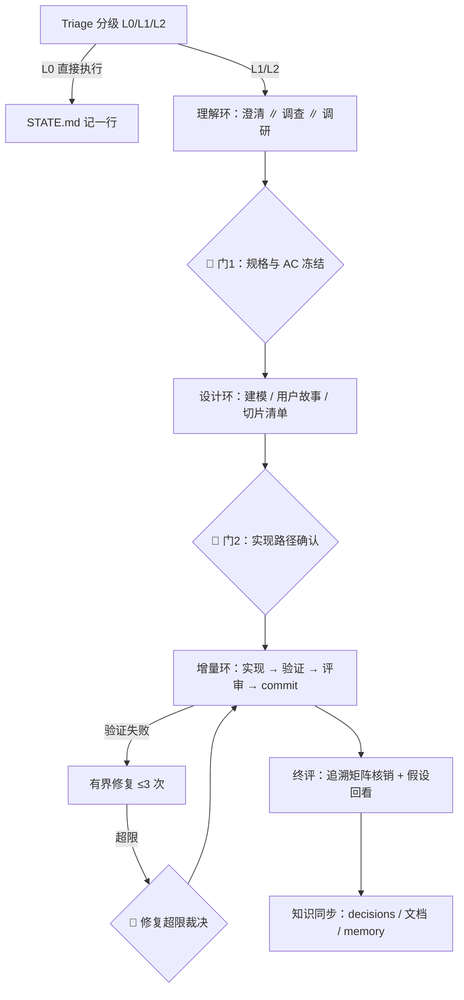

# dev-flow-agents —— AI 编码智能体的统一开发流程

一套以 **SKILL（方法论）+ 角色子智能体（分工）** 为载体的软件开发工作流，为 ZCode 设计，可移植到 Claude Code、Codex CLI。

核心思想：**主智能体只做编排与裁决，不亲自从头干到尾**——需求理解交给分析师、现状调查交给调查员、实现交给实现者、验收交给验证官、评审交给评审官。一切结论落盘为结构化文件，人类只在三个关键门禁出现。

## 它解决什么问题

AI 结对开发的四个通病，各有一条机制对治：

| 通病 | 对治机制 |
|---|---|
| 目标漂移：做着做着偏离初衷，验收标准事后被悄悄放宽 | 验收标准前置冻结，验证官只对冻结 AC 负责，禁止事后放宽 |
| 过程黑盒：人不知道 AI 干到哪了、卡在哪 | STATE.md 是唯一实时真相；三级缩放（驾驶舱 → 阶段产物 → git diff） |
| 质量靠自觉：实现者自己说自己对 | 实现者与评审官**必须跨模型**；验证官逐条 AC 留可复现证据 |
| 门禁泛滥或完全没有：要么步步请示、要么一路狂奔 | 全程仅三处等人（规格冻结 / 路径确认 / 修复超限裁决） |

## 流程总览



切片纪律：**垂直不水平**——每片走通"数据 → 逻辑 → 界面/接口"，禁止"先把所有实体写完再写逻辑"式的分层切法。一片一 commit。

## 仓库结构

```
.agents/skills/dev-flow-agents/SKILL.md   # 方法论主文件（主智能体加载后即生效）
.zcode/agents/*.md                 # 六个角色子智能体（frontmatter 定义模型与工具白名单）
templates/gate-report.md           # 门禁呈报模板（30 秒可读，超一屏先压缩）
templates/spec.md                  # 需求规格模板
examples/STATE.md                  # .project 驾驶舱示例
examples/decisions.md              # ADR 决策日志示例
```

## 安装（ZCode）

1. 把 `.agents/` 与 `.zcode/` 整体拷贝到**你的项目根目录**（与项目现有内容并存即可）。
2. 创建 `.project/` 目录：`templates/` 下放入两个模板，`examples/` 的两个文件放到 `.project/` 根。
3. 在项目 `AGENTS.md` 中加入：

```markdown
## 开发流程（dev-flow-agents）

- 收到任何软件开发需求（新功能 / 修复 / 重构 / 调研落地），先加载 `dev-flow-agents` 技能，按其 Triage 分级与阶段契约执行。
- 流程状态唯一真相：`.project/STATE.md`；阶段产物落盘 `.project/current/`；决策追加 `.project/decisions.md`。
- L0 微改可跳过完整流程直接执行，但完成后必须在 STATE.md 记一行。
- 版本纪律：每个增量切片一次 git commit。
```

4. **重开会话**，使子智能体注册生效。
5. （可选）配置子智能体模型，见下节。

### 模型配置

每个 agent 文件的 frontmatter 有 `model` 与 `thoughtLevel` 字段。把 `model` 改成**你环境中**的 `providerId/modelId` 全名（在 ZCode 里用 ListModels 查看）；删除该行则使用会话默认模型。改完需重开会话生效。

搭配原则（见 SKILL.md 智能体索引）：强推理给分析与评审、强编码给实现、快模型给高频低风险环节；**实现者与评审官必须跨模型**，避免自审自过。

| 角色 | 职责 | 建议档位 |
|---|---|---|
| `req-analyst` 需求澄清分析师 | 歧义识别、澄清问题、规格草案 | 强推理 |
| `surveyor` 现状调查员 | 模块地图、既有实体、约定与坑 | 快模型 |
| `researcher` 参考调研员 | 选型调研，结论必须带来源 | 快模型（联网） |
| `implementer` 实现者 | 一次一片，自测过才交 | 强编码 |
| `verifier` 验证官 | 逐 AC 留证，结论仅 过/未过/无法验证 | 快模型 |
| `reviewer` 评审官 | diff 评审，P0/P1/P2 分级 | 强推理 |

## 使用

对主智能体说一个开发需求即可，例如：

> 实现一个每天抓取 Hacker News 头条、生成中文摘要发到我邮箱的小工具。

流程自动推进：Triage 分级 → 理解环（有歧义会向你提问）→ 门1 规格冻结（等你批准）→ 设计与切片 → 门2 路径确认 → 增量环（一片一提交）→ 终评核销 → 知识同步。

**人类只需要做三类事**：回答澄清问题、批准两道门、在修复 3 次未过时裁决出路。

### 渐进采用

不必一步到位：只装 SKILL.md 也能跑通全流程（缺角色的阶段由主智能体兼任，产物同样落盘）；之后逐个加入子智能体即可，互不影响。

## `.project` 目录约定

```
.project/
├── STATE.md          # 唯一实时真相（驾驶舱，一屏）
├── decisions.md      # 架构/取舍决策日志（只追加，不改写）
├── current/          # 当前需求的活动产物（questions/spec/survey/research/plan/trace-matrix…）
├── requirements/     # 完成需求的归档
└── templates/        # 门禁呈报与规格模板
```

所有阶段产物带标准头（stage/status/inputs/outputs/decisions），不落盘的结论视为不存在。

## 移植到其他工具

流程状态全部是纯文件（Markdown + 目录约定），引擎只是读写方，可替换：

| 概念 | ZCode | Claude Code | Codex CLI |
|---|---|---|---|
| 方法论载体 | `.agents/skills/` | skills / CLAUDE.md | AGENTS.md 引用 |
| 指令文件 | AGENTS.md | CLAUDE.md | AGENTS.md |
| 角色子智能体 | `.zcode/agents/*.md` | `.claude/agents/*.md` | 无原生等价物 → 依 SKILL.md 兜底条款由主智能体兼任 |

## 设计原则（全文见 SKILL.md）

1. **骨架固定、阶段内动态**：阶段顺序与门禁不可临场发明；扇出广度与重试由数据决定。
2. **验收标准前置冻结**：实现开始前 AC 已落盘；之后只对冻结标准负责。
3. **产物落盘、文件交接**：智能体之间只通过结构化文件交接，不靠对话记忆。
4. **观测契约化、三级缩放**：STATE.md 一屏看全局，细节按需下钻。
5. **人工门禁少而精**：全程三处等人；有界修复 3 次超限必须升级，禁止第 4 次糊弄测试。

## License

[MIT](LICENSE)
